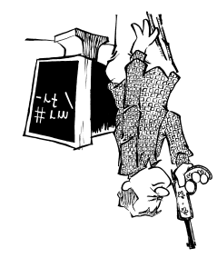

# UNIX 痛恨者手册

本项目是《UNIX 痛恨者手册》（*The UNIX Hater's Handbook*）的简体中文翻译，由 FreeBSD 中文社区译制。

---

*The UNIX Hater's Handbook*

Simson L. Garfinkel、Daniel Weise、Steven Strassmann 等编著

IDG Books Worldwide, Inc. 于 1994 出版

ISBN：978-1568842035

---

伯克利最著名的两大产物是 LSD（麦角酸二乙胺，一种毒品）和 UNIX。

我认为这并非巧合。

---

献给 Ken 和 Dennis，若没有他们，本书将无从谈起。

## 版权说明

原书 *The UNIX Hater's Handbook* 版权归 Simson L. Garfinkel、Daniel Weise、Steven Strassmann 等 所有。

本翻译项目不对原文主张任何权利，翻译内容供学习、研究与交流使用。如权利人提出异议，我们将立即配合处理。

本项目遵循 [BSD 2-Clause 许可证](LICENSE)。
